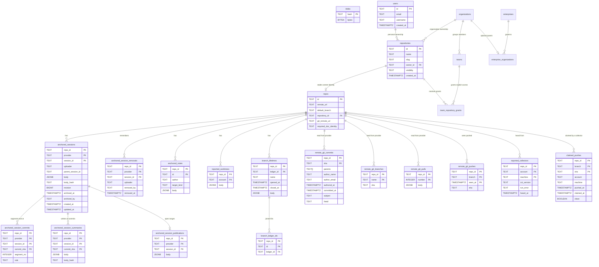

# schemas/ — Shared CLI, Backend, and Frontend Contracts

cxt keeps `cli/` and `backend/` in separate Go modules with independent domain types. The files in `schemas/` are the shared wire and persistence contracts used across the CLI, backend, and frontend.

## What This Directory Defines

| File | Role |
|---|---|
| `cir.schema.json` | CIR v1/v2, the provider-independent format that a Claude Code or Codex conversation is converted to before it is uploaded as a session's conversation document. v2 adds explicit compaction replay state, multi-agent messages, and bounded provider replay metadata. Changes require compatibility review. |
| `openapi.yaml` | OpenAPI 3.1 REST contract shared by CLI, backend, and frontend. A drift test fails when a registered route is missing from it or a path exists only in it. |
| `db/migrations/*.sql` | Ordered PostgreSQL migrations, `0001` through `0171`. `0161` to `0168` add the tables of the session structure; `0169` drops the tables of the earlier capture approach that nothing depends on, and destroys their data; `0170` adds what collectors report about themselves and, to a stored commit, the push it came with; `0171` drops the capture tables that 0169 had to leave, with what still named them, and destroys their data. Runtime services verify the schema and never apply it; see [database migration ownership](../docs/DATABASE_MIGRATIONS.md). |
| `fixtures/` | Fixtures read by tests. |

Ownership migrations and recovery guarantees are documented in
[Repository ownership](../docs/REPOSITORY_ORGANIZATIONS.md).

## REST routes of the session structure

All paths are under `/api/v1/repos/{repoID}`. Most read routes ask for the
viewer role, which a public repository gives to a visitor who is not signed
in. Every write route, the list of removals and the upload routes ask for a
member.

| Route | Purpose |
|---|---|
| `GET /anchored-sessions` | List the sessions the caller may read |
| `GET`, `PUT`, `DELETE /anchored-sessions/{provider}/{sessionID}` | Read, store or remove one session's report |
| `GET /anchored-sessions/{provider}/{sessionID}/events`, `/event-fragments`, `/content` | Read the conversation as far as the caller may read it |
| `GET /anchored-sessions/{provider}/{sessionID}/calls` | The recorded agent calls that name the session |
| `PUT /anchored-sessions/{provider}/{sessionID}/summaries/{sha}` | Store the summary of a session at a commit |
| `PUT /anchored-sessions/{provider}/{sessionID}/archive` | Archive a session or restore it |
| `DELETE /anchored-sessions/{provider}/{sessionID}/removal` | Take back a removal |
| `GET /anchored-removals` | The caller's removed sessions |
| `GET /anchored-commits/{sha}`, `/anchored-commits/{sha}/summaries` | The segments that end at a commit, and the summaries written there |
| `GET /anchored-memory` | The summaries along a branch, the newest commit first |
| `GET /anchored-search` | Search pull requests, branches, commits, conversations and notes |
| `GET`, `POST /anchored-notes`; `PUT`, `DELETE /anchored-notes/{noteID}` | Manual notes |
| `PUT /branch-ids`, `GET /branch-lifetimes` | Register branch IDs; list the lifetimes of branch names |
| `GET`, `PUT /worktrees` | A member's worktree list |
| `GET /remote-git`, `POST /remote-git/refresh` | What the server read from the hosting provider; ask for another read |
| `POST /push/negotiate`, `/push/chunks`, `/push/doc-jobs`, `/push/objects`; `GET /push/doc-jobs/{jobID}` | Upload a conversation document |

`openapi.yaml` is the complete list, including repositories, settings,
secrets and the identity routes.

## DB Schema (selected tables)

A session's report is the `body` of its `anchored_sessions` row. Its
conversation is a document stored as blobs; the report names it.

Earlier migrations also created the tables of the removed capture approach, for
example `snapshots`, `refs` and `pending_contexts`. Migrations 0169 and 0171
drop them, and captures are no longer reachable through the server.

## Usage Principles

1. **Object formats** — The CLI and frontend serialize conversation JSON against `cir.schema.json`. Go structs and TypeScript interfaces may be defined independently, but their fields must conform to the schema.
2. **REST contract** — Both backend routes and the CLI HTTP client treat `openapi.yaml` as the source of truth. Update it first when adding or changing a path, then keep the CLI, backend, and frontend aligned.
3. **Database schema** — SQL files under `db/migrations/` are applied to backend PostgreSQL instances in order, by the operator and not by a runtime service. The CLI and frontend never access the database directly; they use REST only.
4. **Compatibility** — Do not make backward-incompatible changes to the fields, types, or required sets in `cir.schema.json` without an issue, migration plan, and maintainer approval. Adding fields also affects `"additionalProperties": false`.
